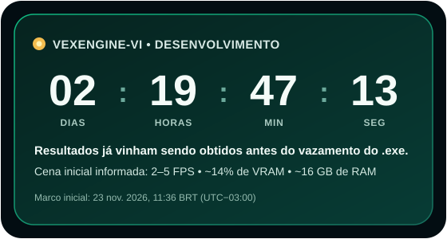

# VexEngine-VI

VexEngine-VI é um projeto autoral de engenharia de execução e renderização para PC, desenvolvido em etapas com prioridade para correção, previsibilidade e estabilidade.

O projeto está em fase inicial. Ainda não é um port funcional, não executa GTA VI e não oferece compatibilidade gráfica completa. O objetivo atual é construir e validar uma base própria de temporização, propriedade por quadro, memória, comunicação D3D12 e apresentação DXGI.

## Tempo de desenvolvimento

O contador parte de 23 nov. 2026, 11:36 BRT (UTC−03:00) e o SVG é atualizado automaticamente a cada cinco minutos pelo GitHub Actions. Para acompanhar os segundos ao vivo localmente, abra [vex-clock.html](vex-clock.html) no navegador.

## Princípios

- Implementação própria; projetos externos servem apenas como referências técnicas e fontes de hipóteses.
- Nenhuma espera ativa ou bloqueio síncrono desnecessário na thread de submissão.
- Valores de fence de 64 bits monotônicos e verificáveis.
- Recursos de um quadro não podem ser reutilizados antes da conclusão de todas as filas que os utilizam.
- Dados de câmera são capturados em snapshots imutáveis por quadro.
- Simulação e frequência de apresentação devem ser desacopladas.
- Orçamento de memória explícito, preservando margem para sistema e driver.
- Código inseguro fica restrito aos módulos de integração com APIs nativas.

## Estado atual

| Subsistema | Estado |
|---|---|
| Workspace Rust | Inicializado |
| Acumulador de simulação fixa | Implementado + testes |
| Slots de quadros / timelines | Política CPU implementada + testes |
| Snapshot imutável de câmera | Implementado + testes |
| Orçamento contábil de memória | Implementado + testes |
| Enumeração DXGI e seleção de adaptador | Testada na RX 6650 XT |
| Criação de dispositivo D3D12 | Testada na RX 6650 XT |
| Fila direta e fence de 64 bits | Testadas no hardware |
| Três pares de command allocator/list | Seis submissões reais concluídas |
| Janela Win32 e swap chain DXGI | Criada e executada na RX 6650 XT |
| Render target, clear e transições | Executados sem erro reportado pelo D3D12 |
| Present e sincronização por back buffer | Executados; fence final concluída; confirmação visual humana pendente |
| Resize seguro da swap chain | Implementado e testado com 3 redimensionamentos externos (4 eventos WM_SIZE) |
| Diagnóstico de device removed | Parcial: HRESULT de Present/ResizeBuffers + GetDeviceRemovedReason; recuperação pendente |
| Fontes HLSL + bytecode VS/PS 5.1 | Compilados; pipeline ainda não conectado |
| Geometria / draw calls | Não implementados |
| Upload heaps / streaming | Não implementados |
| Integração com GTA VI | Não implementada |
| Contrato tipado de configurações do runtime | Implementado + 5 testes |
| Classificação Live / RestartGame | Implementada; ainda sem painel/IPC |
| Meta de 60 FPS | Planejada, não habilitada |

## Compilar e testar

Requer Rust stable e Windows SDK.

Testes do núcleo:

    cargo test --workspace
    cargo clippy --workspace --all-targets --features windows-backend -- -D warnings

Probe de comunicação D3D12:

    cargo run -p vex-core --features windows-backend --bin vex-gpu-probe

Primeiro teste visual DXGI (janela 1280x720; 15 segundos por padrão, duração configurável):

    cargo run -p vex-core --features windows-backend --bin vex-visual-test
    cargo run -p vex-core --features windows-backend --bin vex-visual-test -- 60

O teste visual foi executado por 60 segundos na RX 6650 XT: 3.547 apresentações foram submetidas e a fence final foi concluída em 3.547. A janela Win32 foi capturada visível com o render target preenchido; essa validação cobre apenas clear + Present, não geometria, shaders ou desempenho do jogo. A pausa de 16 ms do utilitário é proteção contra saturação da CPU e não constitui benchmark nem comprova 60 FPS.

## Estrutura

    crates/vex-core/src/frame/          Posse de slots e snapshots
    crates/vex-core/src/timing/         Temporização de simulação
    crates/vex-core/src/memory/         Orçamento de memória
    crates/vex-core/src/runtime_settings.rs
                                        Contrato e validação de configurações
    crates/vex-core/src/platform/d3d12.rs
                                        Dispositivo, fila e fences D3D12
    crates/vex-core/src/platform/presentation.rs
                                        Janela, swap chain e apresentação DXGI
    crates/vex-core/src/bin/            Ferramentas de validação
    assets/shaders/                     Fontes HLSL e bytecode compilado
    docs/architecture/                  Arquitetura e fluxos técnicos
    docs/decisions/                     Decisões de projeto
    docs/TEST-PLAN.md                   Plano de testes

## Hardware de referência

- AMD Radeon RX 6650 XT — 8 GB de VRAM
- Intel Xeon E5-2680 v4
- 32 GB de RAM
- Windows 10 Pro 22H2

O probe identificou a RX 6650 XT (Vendor ID 0x1002), com 7,96 GiB de memória dedicada reportada, criou o dispositivo D3D12, submeteu seis command lists e confirmou o progresso da fence até o valor 7.

## Roadmap

1. Confirmar apresentação DXGI estável e encerramento limpo.
2. Implementar resize e tratamento de perda de dispositivo.
3. Adicionar geometria de teste e shaders compilados.
4. Criar buffers de upload e recursos imutáveis por quadro.
5. Instrumentar frame pacing, latência e orçamento dinâmico de memória.
6. Implementar streaming e cache de pipelines/shaders.
7. Desacoplar simulação e apresentação; avaliar 60 FPS.
8. Planejar integração progressiva com o ambiente-alvo.

## Documentação

- [Fundação técnica](docs/architecture/FOUNDATION.md)
- [Probe D3D12](docs/architecture/WINDOWS-D3D12-PROBE.md)
- [Apresentação DXGI](docs/architecture/DXGI-PRESENTATION.md)
- [Plano de testes](docs/TEST-PLAN.md)
- [Painel e configurações do runtime](docs/architecture/RUNTIME-CONTROL-PLANE.md)
- [Primeiros shaders](docs/architecture/FIRST-SHADERS.md)
- [Changelog](CHANGELOG.md)

## Integridade

O probe D3D12 e o caminho inicial de apresentação foram executados no hardware de referência. A fila apresentou 832 quadros de clear e concluiu a fence correspondente. A aprovação visual depende de confirmação na tela; ainda não alegamos renderização de geometria, estabilidade prolongada, desempenho em jogo ou 60 FPS. A licença existente no repositório é GNU GPL versão 2 e permanece inalterada; a decisão de licenciamento deve ser revisada antes de qualquer distribuição pública.

